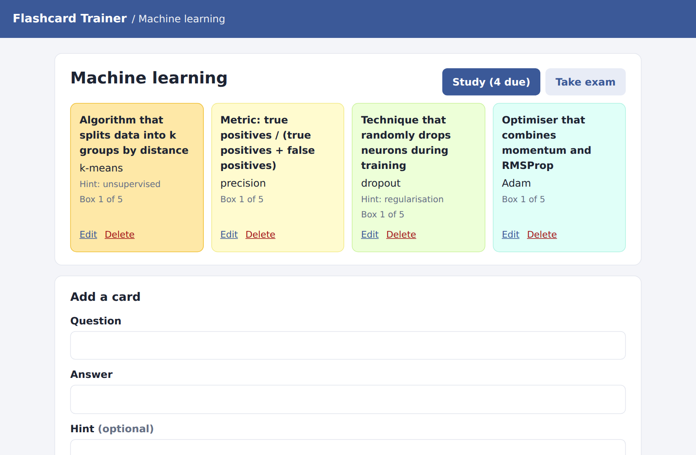
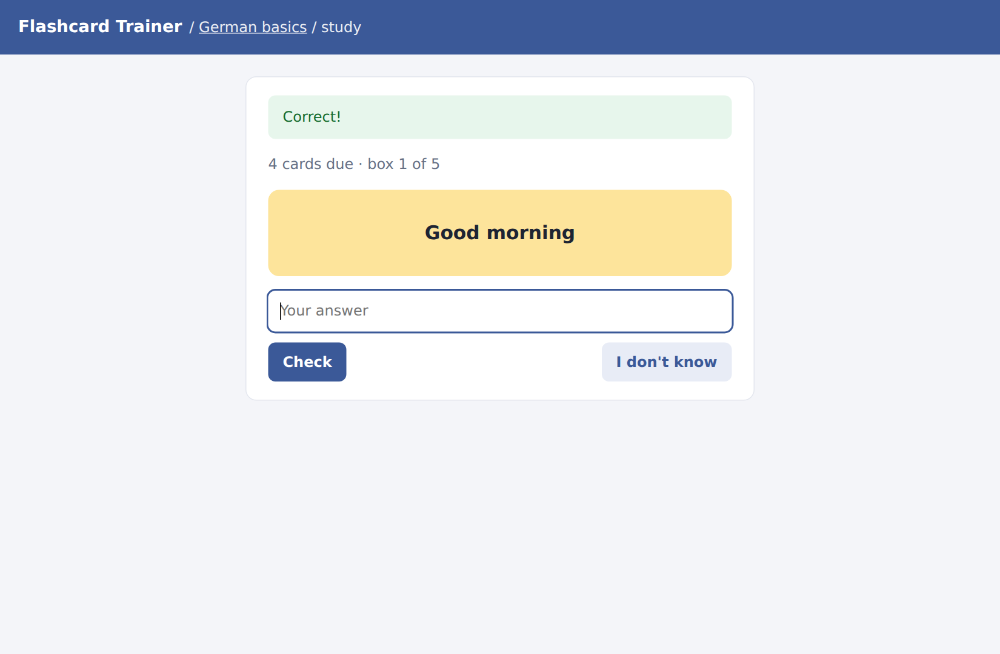

# Flashcard Trainer

[](https://github.com/dhruvilkatharotiya01/Flash-Card-Trainer-Web-App/actions/workflows/ci.yml)

A small Flask web app for learning with flashcards. Create decks, add cards with
optional hints, practise with a **spaced-repetition study mode**, or take an
**exam** over a whole deck and get a score.

| Decks | Study mode |
|---|---|
|  |  |

## Features

- **Decks and cards**: create, edit and delete; optional hints; colour-coded cards
- **Study mode with spaced repetition** (Leitner system): every card sits in one of five
  boxes. A correct answer moves it up a box and it comes back after 1, 3, 7 or 14 days;
  a wrong answer sends it back to box 1 so it is asked again straight away. The hardest
  cards are shown first.
- **Exam mode**: goes through the whole deck in random order, counts right, wrong and
  skipped answers and shows a final score
- **Lenient answer checking**: ignores case, punctuation, extra spaces and articles
  ("the k-means" = "k-means")
- **Safe by default**: CSRF tokens on every form, secret key from the environment,
  escaped output, debug mode off, atomic file writes
- Tests, linting, Docker image and GitHub Actions CI

## Run it

```bash
python -m venv .venv && source .venv/bin/activate
pip install -r requirements-dev.txt
python app.py                      # http://127.0.0.1:5000
```

The first start creates `instance/flashcards.json` with three demo decks.

With Docker:

```bash
docker compose up --build          # http://localhost:8000
```

Set `SECRET_KEY` to a long random value in production (`openssl rand -hex 32`).

## Tests

```bash
python -m pytest -q                # 20 tests: scheduler, storage, answer checking, routes
ruff check . && ruff format --check .
```

## How it is built

```
app.py                 development entry point (gunicorn uses app:app)
flashcards/
  __init__.py          app factory, configuration, CSRF check, error pages
  routes.py            decks, cards, study and exam routes
  scheduler.py         Leitner spaced-repetition scheduling
  answers.py           answer normalisation and comparison
  storage.py           JSON storage with atomic writes and a write lock
  templates/, static/  Jinja templates with one shared layout, one stylesheet
data/demo_decks.json   demo content loaded on first start
tests/                 unit and Flask test-client tests
```

Storage is a single JSON file because the data is small and it keeps the app
dependency-free; `storage.py` is the only module that would change to use SQLite
or PostgreSQL. The exam state lives in the signed session cookie.

## Background

The app started as a team project (Team 11) in the Software Engineering course at
Technische Hochschule Ingolstadt, where it was developed on GitLab with Docker-based
CI/CD. This repository is my continued version. Compared with the course version it:

- fixes exam scores that were not saved between questions (nested session data was
  changed in place, so Flask never stored it)
- turns the unused review-interval class into a working spaced-repetition study mode
- moves the inline HTML into Jinja templates with a shared layout and stylesheet
- adds CSRF protection, environment-based configuration and stable card IDs
  (cards were addressed by list position before), plus tests and CI

## Roadmap

- [ ] User accounts so several people can keep their own decks
- [ ] Import and export of decks as CSV
- [ ] SQLite storage
